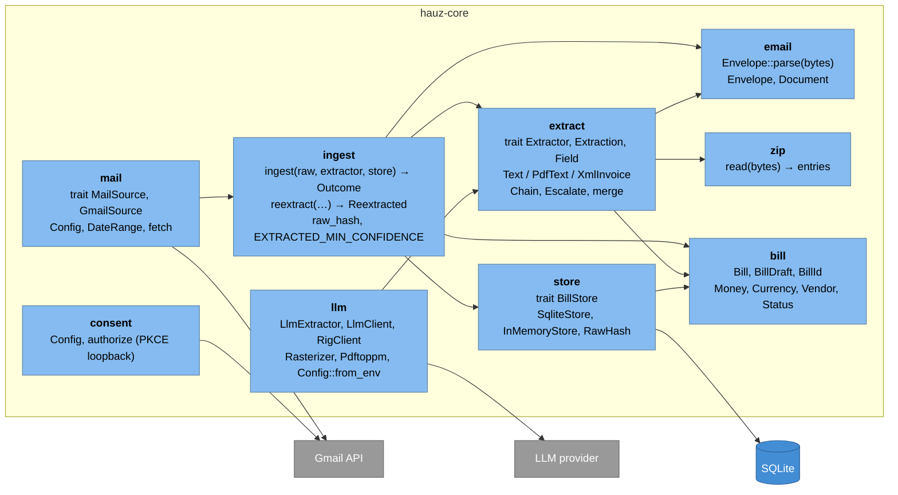

# L3 Core components

*Verified against: `unaudited`*

`hauz-core` (`crates/core`) holds every domain rule. Each box is a public module and lists
the interface it exposes. Arrows show which module uses which. The binaries call only the
modules named in the table below.

| Module | Owns | Used directly by |
|---|---|---|
| `bill` | the domain vocabulary; a `Bill` exists only through `TryFrom<BillDraft>` | all binaries |
| `email` | MIME decoding of raw RFC 5322 bytes | `ingest`, `extract` |
| `extract` | "envelope ⇒ candidate fields with confidence"; composition with `Chain` / `Escalate` | server, `hauz` |
| `llm` | LLM client edge, PDF rasterizer edge, `LlmExtractor` | server, `hauz` |
| `zip` | std-only archive reading (DIAN zips) | `extract` |
| `store` | persistence, idempotency by `RawHash` | all binaries |
| `ingest` | the pipeline hash → short-circuit → parse → extract → build → insert | server, `hauz`, `mail` |
| `mail` | Gmail listing and fetch, poll query | server (poller), `hauz fetch` |
| `consent` | Gmail OAuth consent (PKCE S256, loopback) | `hauz gmail-auth` |

Item-level documentation: `cargo doc -p hauz-core --open`.
