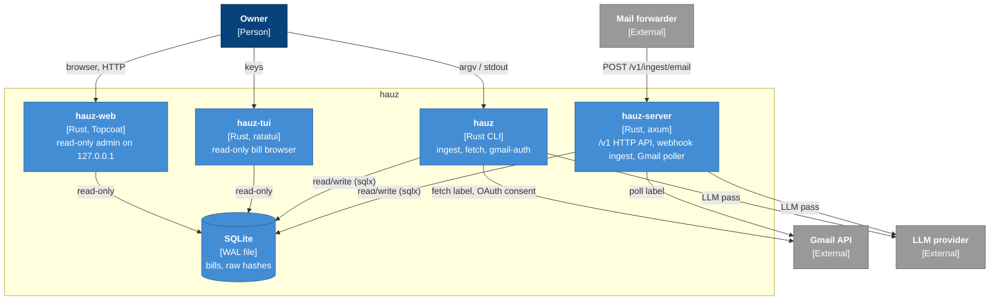

# L2 Containers

*Verified against: `unaudited`*

The four binaries share one library (`hauz-core`) and one SQLite file. Only the server and
`hauz` write to the file; `hauz-tui` and `hauz-web` open it read-only.

| Container | Exposes | Reads env | Details |
|---|---|---|---|
| `hauz-server` | `/v1` HTTP on `BIND_ADDR` | `HAUZ_API_TOKEN`, `DATABASE_URL`, `BIND_ADDR`, LLM, Gmail | [HTTP API](../reference/api.md) |
| `hauz` | `ingest`, `fetch`, `gmail-auth` | LLM, Gmail | [CLI](../reference/cli.md) |
| `hauz-tui` | terminal UI | none | [CLI](../reference/cli.md#hauz-tui) |
| `hauz-web` | HTML pages on `127.0.0.1:<port>` | none | [Web admin](../reference/web.md) |
| SQLite | one file plus `-wal`/`-shm` | — | [Build and run](../setup/index.md#the-database) |
