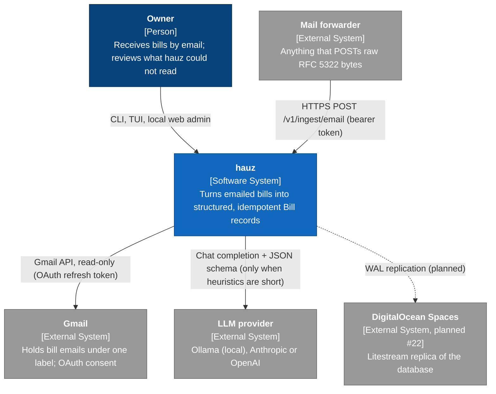

# L1 System context

*Verified against: `unaudited`*

This diagram shows the persons and systems that connect to hauz. One owner operates hauz.
A blue box is hauz. A grey box is an external system. A dashed arrow is a planned connection.

| Boundary | Protocol | Direction | Credential |
|---|---|---|---|
| Owner ↔ hauz | process arguments, stdout and exit codes, terminal, HTTP on `127.0.0.1` | in | none (local) |
| Forwarder → hauz | HTTP `/v1` | in | `HAUZ_API_TOKEN` bearer |
| hauz → Gmail | HTTPS REST, OAuth 2.0 | out | `HAUZ_GMAIL_*` |
| hauz → LLM | HTTPS (or local HTTP for Ollama) | out | provider key |
| hauz → Spaces | S3 API via Litestream (planned) | out | — |
