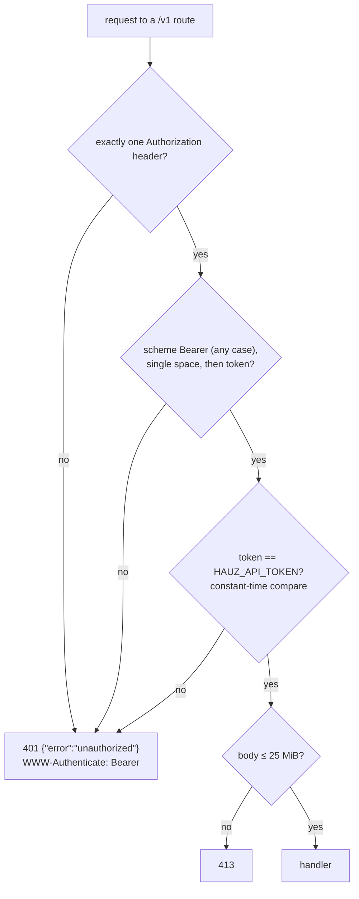

# API authentication

*Verified against: `unaudited`*

Every matched `/v1` route sits behind one bearer guard that runs before the handler, so an
unauthenticated client cannot make the server buffer a body.

- Missing and wrong tokens get the same response.
- The server refuses to start without a non-blank `HAUZ_API_TOKEN`.
- Unmatched paths are not guarded and answer 404.
- `hauz-web` has **no** auth and binds `127.0.0.1` only.
