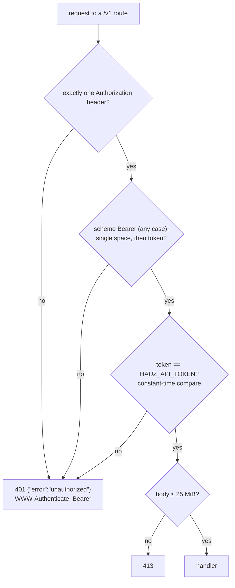

# API authentication

*Verified against: `unaudited`*

One bearer guard protects each `/v1` route. The guard runs before the handler. Thus a
client without a correct token cannot make the server read a body into memory.

- A missing token and a wrong token get the same response.
- The server does not start if `HAUZ_API_TOKEN` is not set or is blank.
- The guard does not protect a path that has no route. That path gives 404.
- `hauz-web` has **no** authentication. It listens on `127.0.0.1` only.
