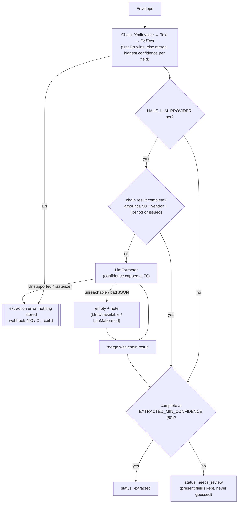

# Extraction decision

*Verified against: `unaudited`*

How an envelope becomes `extracted` or `needs_review`. The heuristic chain always runs. The
LLM runs only when an LLM provider is configured and the chain's result is incomplete.

- **Completeness** = an amount at or above the threshold, plus a vendor, plus a period or an
  issue date.
- **Confidence** runs from 0 to 100. DIAN XML invoices score 100. The header-derived vendor
  (the sender's display name, else its domain) scores 20.
- Notes such as `NoTextLayer` are not persisted.
