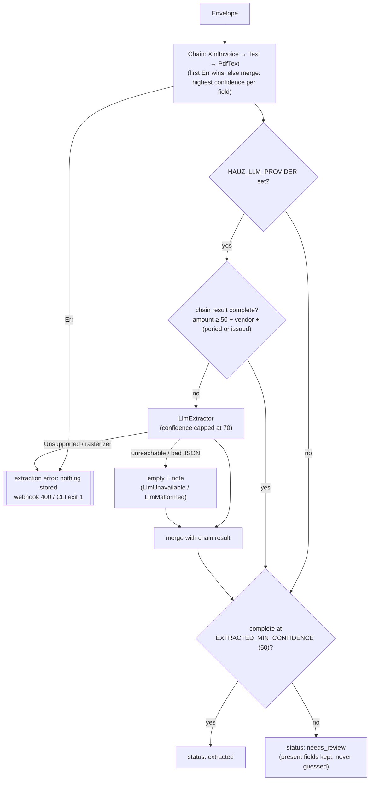

# Extraction decision

*Verified against: `unaudited`*

This flow shows how hauz gives an envelope the status `extracted` or `needs_review`. The
heuristic chain always runs. The LLM runs only if you set an LLM provider and the result of the
chain is not complete.

- **Complete result:** an amount with a confidence of 50 or more, a vendor, and a period or
  an issue date.
- **Confidence:** a value from 0 to 100. A DIAN XML invoice gets 100. A vendor from the email
  header gets 20. This vendor is the display name of the sender, or else the domain.
- **Notes:** hauz does not keep notes, for example `NoTextLayer`, in the database.
