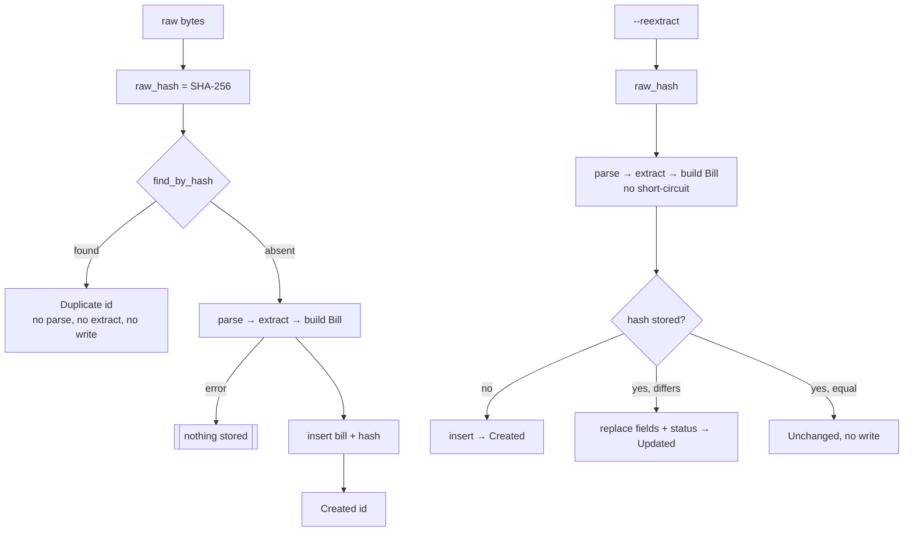

# Ingest idempotency

*Verified against: `unaudited`*

The same raw bytes always give the same bill. The bill id is the hex SHA-256 of the raw
email.

Thus hauz stores no new bill when:
- you ingest the same folder again;
- you run `hauz fetch` again over a range that overlaps a previous range;
- a forwarder sends the same webhook again.

A change to an extractor does not change the stored bills. To apply the change to a stored
bill, run `hauz ingest --reextract`.
