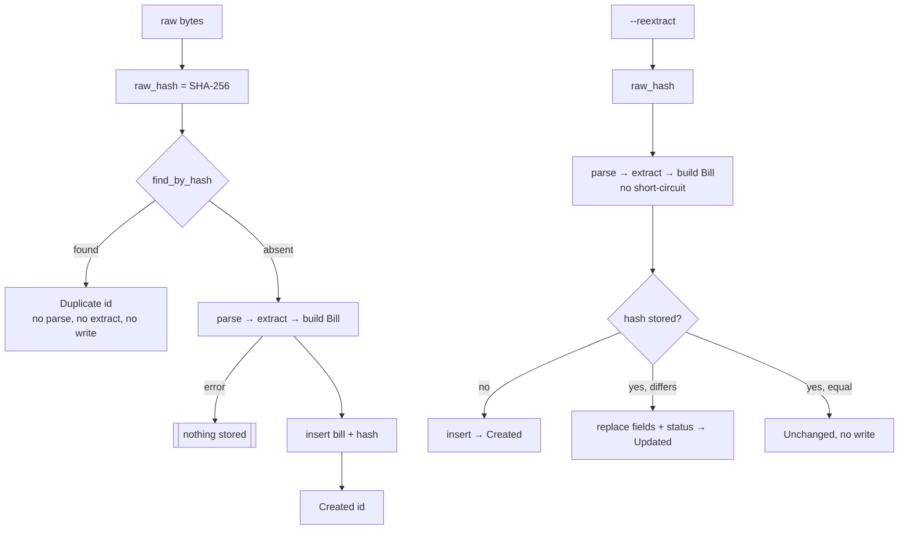

# Ingest idempotency

*Verified against: `unaudited`*

The same raw bytes always map to the same bill. The bill id is the hex SHA-256 of the raw
email.

Consequences: replaying a folder, re-running `hauz fetch` over an overlapping range, or a
forwarder retrying a webhook stores nothing new. Improving an extractor does not touch
stored rows until you run `--reextract`.
