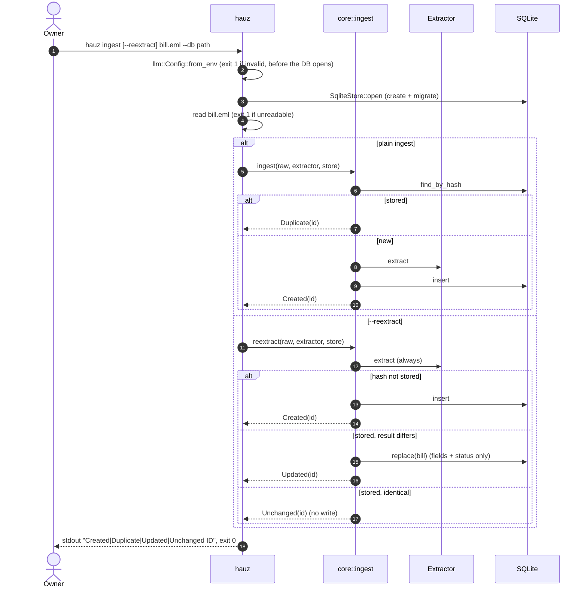

# hauz ingest / --reextract

*Verified against: `unaudited`*

`hauz ingest <file.eml>` runs the same pipeline as the webhook against one file.
`--reextract` skips the hash short-circuit and overwrites a stored row with the new result.

