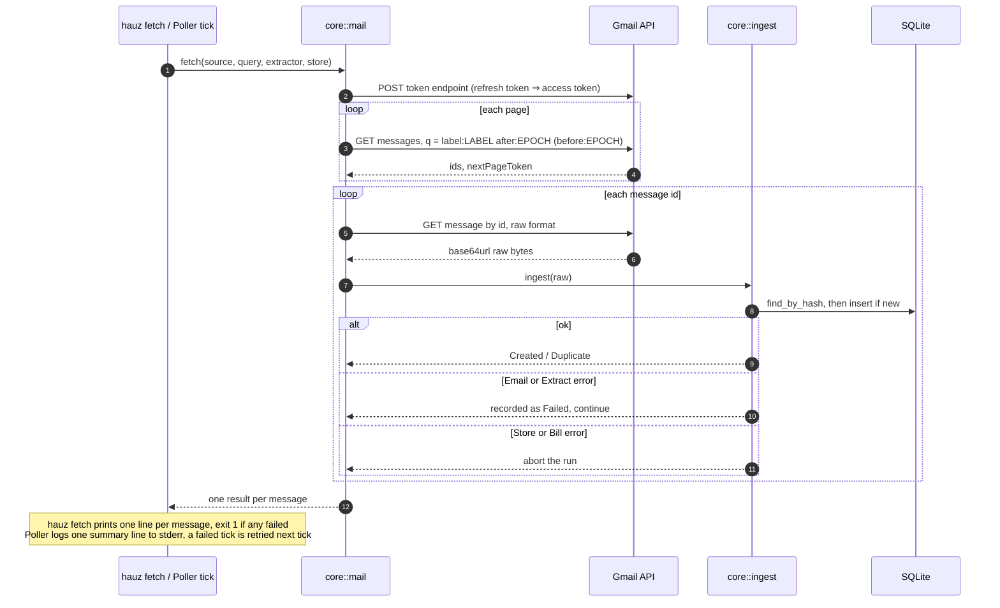

# hauz fetch and the server poller

*Verified against: `unaudited`*

`hauz fetch` and the poller list one Gmail label and ingest each message. `hauz fetch` runs
one time, over the UTC days that you give. The poller runs when the server starts. Then it
runs each `HAUZ_GMAIL_POLL_SECS` seconds. It reads the messages from UTC midnight of the
previous day.

You can run over the same days again. A stored message gives `Duplicate`
([ingest idempotency](../flows/idempotency.md)). An authentication, transport or store error
stops the run. The bills that hauz stored before the error stay in the database.
