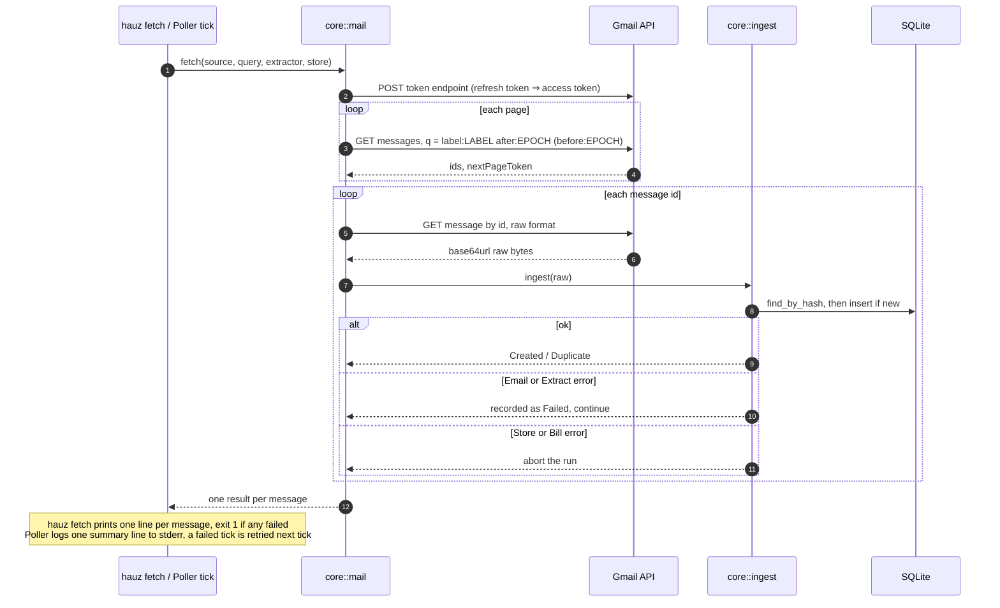

# hauz fetch and the server poller

*Verified against: `unaudited`*

Both list one Gmail label and push every message through `ingest`. `hauz fetch` runs once
over a caller-given UTC day range. The server poller runs at startup and then every
`HAUZ_GMAIL_POLL_SECS` seconds, over the window since UTC midnight yesterday.

Overlapping runs are safe: an already-stored message is `Duplicate` (see
[ingest idempotency](../flows/idempotency.md)). Auth, transport or store errors stop the run;
bills stored before the stop stay stored.
