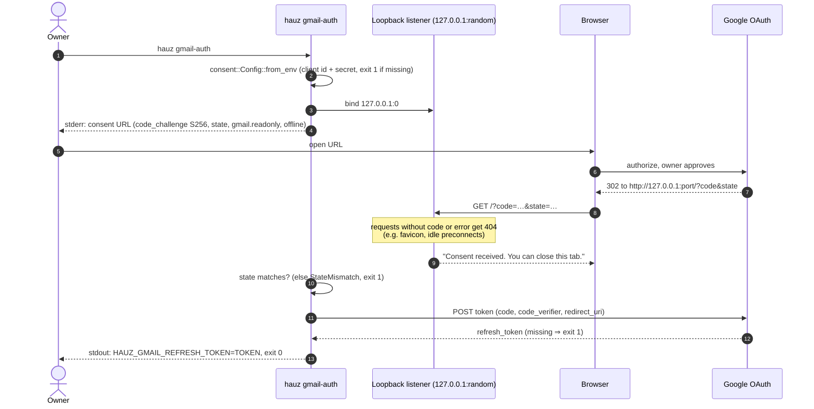

# hauz gmail-auth (PKCE loopback)

*Verified against: `unaudited`*

You do this consent one time. It writes a refresh token. The `state` and the PKCE verifier
come from 64 bytes of `/dev/urandom`.

