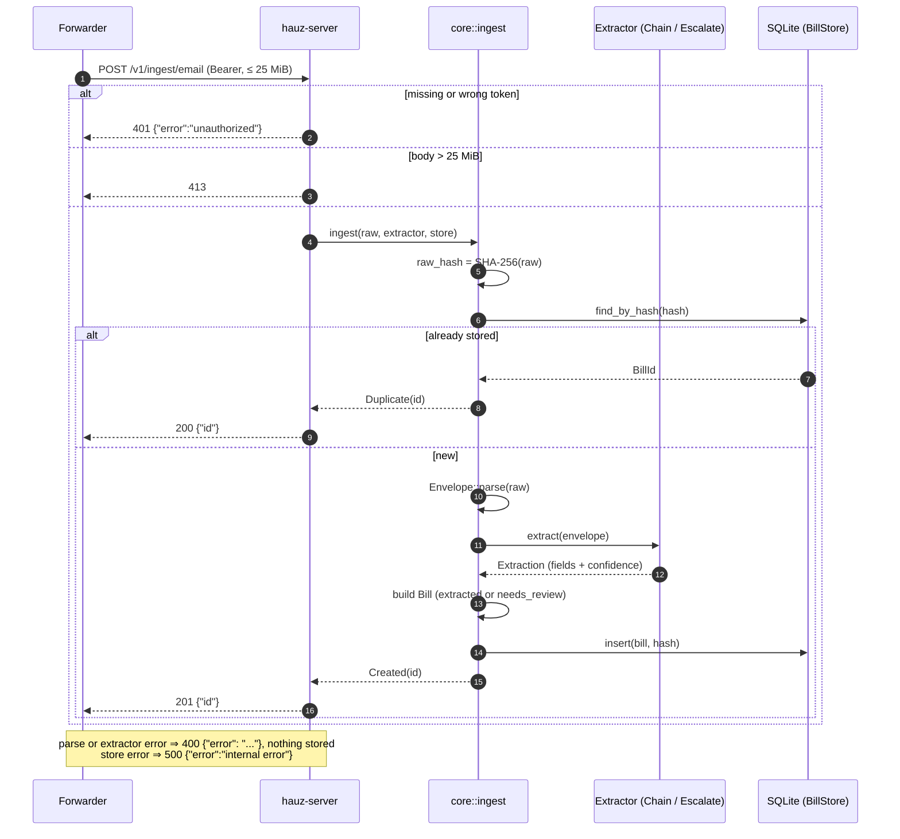

# Webhook ingest

*Verified against: `unaudited`*

A client sends `POST /v1/ingest/email` with the raw RFC 5322 bytes as the body. The server
examines the token before it reads the body ([API auth flow](../flows/auth.md)).

